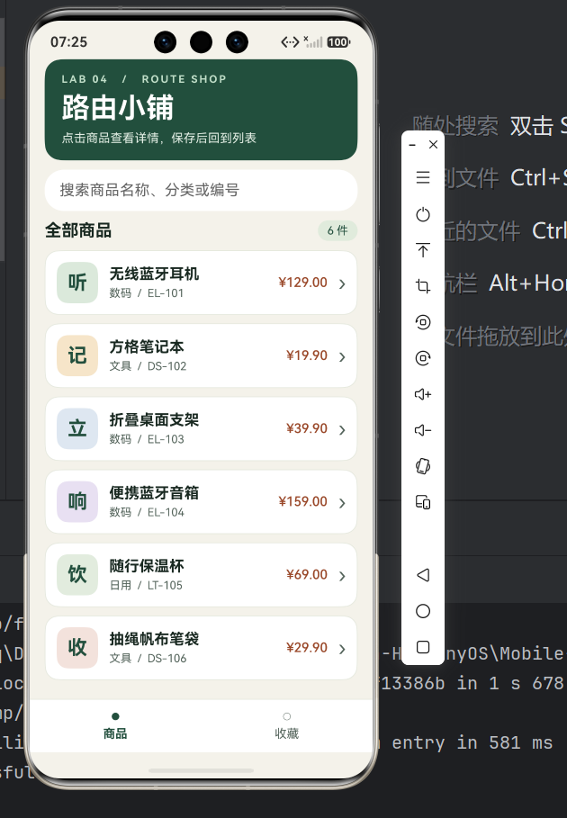
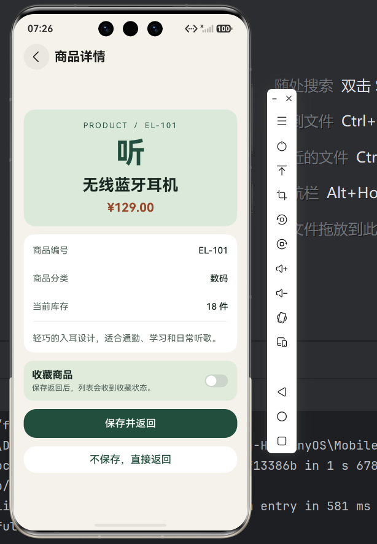
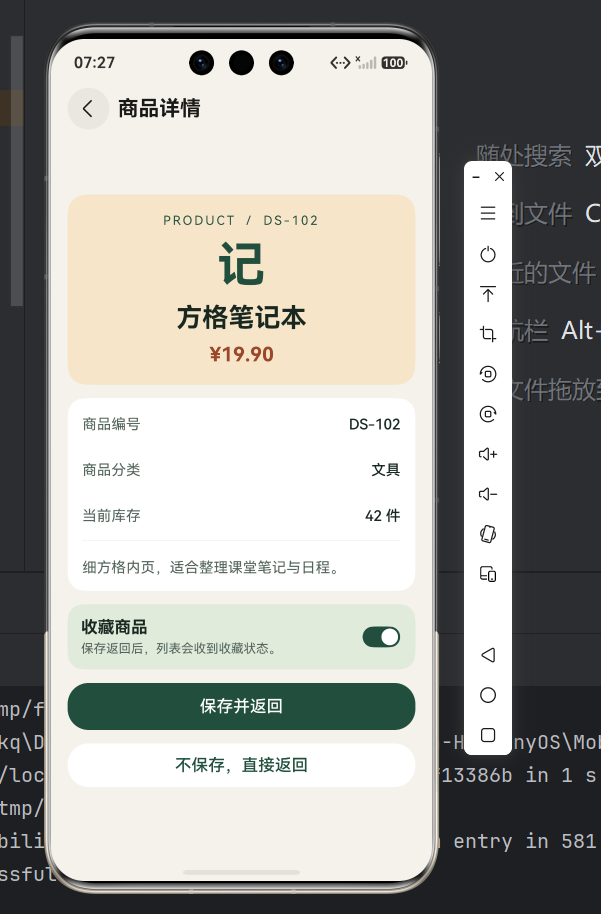
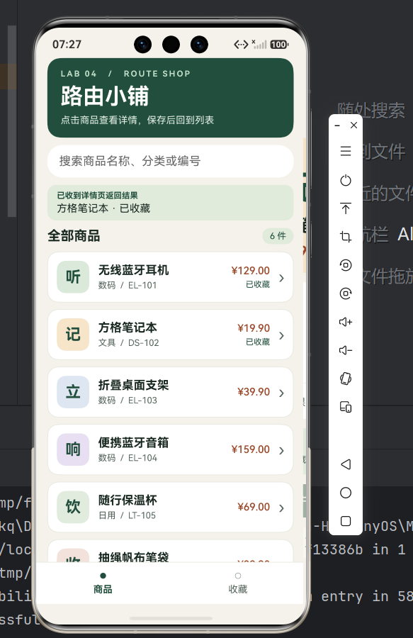
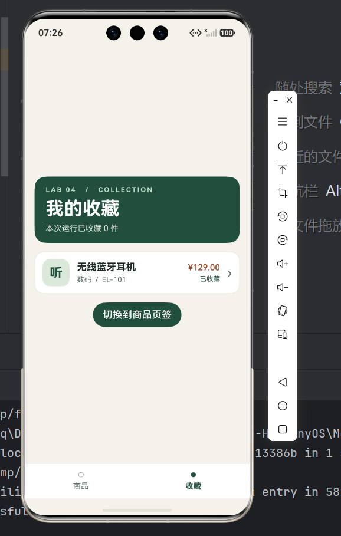

# 实验四 · 路由小铺

用 ArkTS 和 ArkUI 写的鸿蒙商品列表。点商品可以查看详情，在详情页改完收藏状态后，点「保存并返回」，商品列表会更新。底部有「商品」和「收藏」两个页签。收藏只在本次运行有效，重启后清空。

## 运行

1. 解压后用 DevEco Studio 打开含 `build-profile.json5` 和 `entry` 的目录。Windows 上建议放在 `D:\Lab04` 这类短路径下。
2. 等工程同步完成，在 Device Manager 启动鸿蒙手机模拟器。工程使用 DevEco Studio 26.0.0 工具链，兼容 HarmonyOS 6.0.0（API 20）及以上。
3. 顶部选 `entry` 和模拟器，点绿色运行按钮。应用名称是「路由小铺」，不用 HBuilderX。

## 路由

列表的点击回调收到当前商品，`pushPathByName()` 把商品 ID 和当前收藏状态传给详情页。详情页在 `onReady` 里读取 ID，再查商品数据。「保存并返回」调用 `pop(result)`，列表在 `onPop` 里接收结果并更新收藏。「不保存，直接返回」只调用 `pop()`，不会修改收藏。

底部页签由 `Tabs` 管理，点击标签或调用 `TabsController.changeIndex()` 只切换首页内容，不会把新页面压入导航栈。首页注册在 `main_pages.json`，商品详情注册在 `router_map.json`，两份配置均由 `module.json5` 引用。

## 运行截图

截图来自 Mate 90 Pro 鸿蒙模拟器。

| 商品列表 | 耳机详情 | 详情中开启收藏 |
| --- | --- | --- |
|  |  |  |

| 保存后返回列表 | 收藏页签 |
| --- | --- |
|  |  |

## 源码位置

- `entry/src/main/ets/pages/Index.ets` 管理商品、收藏页签和导航栈。
- `entry/src/main/ets/components/ProductList.ets` 渲染列表并处理商品点击。
- `entry/src/main/ets/pages/ProductDetail.ets` 展示商品详情，保存时返回收藏结果。
- `entry/src/main/ets/model/Catalog.ets` 存放演示商品和查询逻辑。
